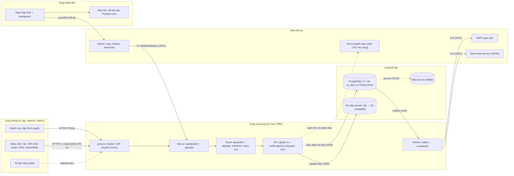

# THREAT-MODEL — X-Company (STRIDE + OWASP Top 10:2025, G4)

> Phạm vi: web Next.js (website công khai + `/app` nội bộ/PWA), API, PostgreSQL, kho tệp, worker, CI/CD và vòng phát triển bằng agent.
> Ngoài phạm vi: hạ tầng máy chủ/mạng của nhà cung cấp (chưa chọn — `<chủ dự án điền>`), thiết bị nhân viên, hệ lương/kế toán nhận CSV.
> Rà lại khi thêm tích hợp hoặc ranh giới tin cậy mới; script `npm run -s check:docs` bắt `updated` cũ hơn ADR mới nhất.
> Bằng chứng ghi `(có)` = tệp tồn tại trong repo lúc 2026-10-18 (script kiểm); `(chưa có: T-NNN)` = test/cấu hình nằm trong task PLAN chưa làm — **chưa phải bằng chứng**. Mã `S-*` trong cột bằng chứng phải xuất hiện trong tiêu đề test (script kiểm).

## 1. Tài sản
| ID | Tài sản | Phân loại | Nếu lộ / sửa / mất |
|---|---|---|---|
| A-01 | Hồ sơ nhân sự (họ tên, email, SĐT, ngày vào/nghỉ) | cá nhân | vi phạm Luật 91/2025/QH15; mất tin cậy |
| A-02 | Dữ liệu định vị chấm công (lat/lng/độ chính xác) | nhạy cảm | NĐ 356/2025: ĐGTĐ + thông báo vi phạm 72 giờ |
| A-03 | Bảng công đã khoá, đơn OT/nghỉ, xuất công | toàn vẹn | sai lương/công, tranh chấp lao động |
| A-04 | Hồ sơ ứng viên, hộp tiếp nhận khách | cá nhân | lộ thông tin người ngoài |
| A-05 | Tệp nội bộ (hồ sơ dự án, bằng chứng nghiệm thu) | nội bộ | lộ thông tin thương mại |
| A-06 | Phiên đăng nhập, mật khẩu băm, khoá ký phiên/QR (`SESSION_SECRET`, `QR_SIGNING_KEYS`) | bí mật | chiếm tài khoản, chấm công giả |
| A-07 | Nhật ký kiểm toán (chuỗi băm) | toàn vẹn | mất khả năng truy vết |
| A-08 | Mã nguồn, CI, chỉ dẫn agent (`AGENTS.md`, `.claude/`) | toàn vẹn | chèn mã độc, agent bị điều khiển |

## 2. Sơ đồ luồng dữ liệu (DFD) và ranh giới tin cậy

| Ranh giới | Giữa | Kiểm soát chính |
|---|---|---|
| TB-A | Internet/thiết bị ↔ web | TLS, proxy (CSP, header), phiên `__Host-` HttpOnly, CSRF, rate limit, zod |
| TB-B | ứng dụng ↔ DB/kho tệp/sao lưu | role DB tối thiểu quyền, SQL tham số, tải tệp qua route kiểm quyền, mã hoá bản sao lưu |
| TB-C | worker ↔ SMTP/Push | TLS, không gửi PII thừa trong nội dung, thử lại có giới hạn |
| TB-D | agent/CI ↔ repo/production | ruleset nhánh, CODEOWNERS, hook guard, gitleaks, dep-audit; nội dung ngoài là dữ liệu, không phải chỉ thị |

Nội dung ngoài ↔ LLM: sản phẩm P0 **không** có thành phần LLM; ranh giới agent ↔ tool chỉ ở vòng phát triển (TB-D, luật ở `AGENTS.md` §4, §6).

## 3. Kẻ tấn công giả định
| Ai | Năng lực | Mục tiêu | Mối đe doạ chính |
|---|---|---|---|
| Người lạ trên Internet | gửi request tuỳ ý, tự động hoá, nhồi mật khẩu | lấy dữ liệu, chiếm tài khoản, phá dịch vụ | T1, T8, T10, T13, T14 |
| Nhân viên đã đăng nhập, ác ý | hợp lệ, biết hệ thống | xem/sửa dữ liệu người khác, tự duyệt, chấm công hộ | T2, T4, T6, T11 |
| Quản trị/DBA bất cẩn hoặc ác ý | quyền DB/máy chủ | sửa công, xoá dấu vết | T3, T5, T12, T17, T19 |
| Người trong chuỗi cung ứng (gói npm, GitHub Action) | chèn mã vào phụ thuộc | thực thi mã trên CI/production, lấy bí mật | T15, T16 |
| Thiết bị chung/mất | người sau dùng chung trình duyệt | đọc dữ liệu người trước | T7, T21 |
| Người nghiên cứu bảo mật | thử nghiệm thiện chí | báo lỗ hổng | kênh `SECURITY.md` |

## 4. Mối đe doạ, mức rủi ro và quyết định
Mức = Khả năng × Tác động, mỗi bậc 1 (Thấp) · 2 (Trung bình) · 3 (Cao): tích 1–2 **Thấp**, 3–4 **TB**, ≥ 6 **Cao**.
Quyết định ∈ mitigate / eliminate / transfer / accept. Bằng chứng: tệp thật; `(chưa có: T-NNN)` xem đầu tài liệu.

| ID | STRIDE | Mối đe doạ | KN | TĐ | Mức | Quyết định | Biện pháp | Bằng chứng | Trạng thái |
|---|---|---|---|---|---|---|---|---|---|
| T1 | Spoofing | Đoán/nhồi mật khẩu | 2 | 3 | Cao | mitigate | Argon2id, 5 lần/15 phút/(email, IP), TOTP cho vai trò nhạy cảm | `tests/http/auth.test.ts` S-ID-07 (có) | mở |
| T2 | Spoofing | Chấm công hộ / QR chụp lại | 3 | 2 | Cao | mitigate | QR ký HMAC TTL 60 s gắn ca + địa điểm, ngoại lệ cần xác minh; không cam kết tuyệt đối | `tests/http/attendance-events.test.ts` S-AT-09 (có) | mở |
| T3 | Tampering | Sửa công/kỳ khoá trực tiếp | 2 | 3 | Cao | mitigate | sự kiện gốc chỉ thêm, adjustment có duyệt, kỳ khoá bất biến, audit chuỗi băm | `tests/db/audit.test.ts` S-ID-08 (có); `tests/db/period.test.ts` S-AT-07 (có) | một phần |
| T4 | Tampering | Gửi lặp / phát lại hàng chờ | 3 | 2 | Cao | mitigate | `idempotency_key` UNIQUE, so nội dung, khoá lạc quan `version` | `tests/http/attendance-events.test.ts` S-AT-03 (có); `tests/db/tasks.test.ts` S-WK-06 (có) | mở |
| T5 | Repudiation | Chối thao tác duyệt | 2 | 2 | TB | mitigate | `audit_event` ghi actor/lý do/kết quả cùng giao dịch, cả `denied` | `tests/db/audit.test.ts` (có) | đã giảm |
| T6 | Info disclosure | IDOR công/tệp/xuất ngoài phạm vi | 3 | 3 | Cao | mitigate | `can()` ở server mọi route; tải tệp qua route kiểm quyền; test "bị cấm" từng route | `tests/db/org.test.ts` R7 chéo công ty (có); `tests/unit/authz.test.ts` S-ID-01..06 (có) | một phần |
| T7 | Info disclosure | Dữ liệu người trước còn trên thiết bị chung | 2 | 2 | TB | mitigate | IndexedDB theo user, xoá khi đăng xuất, `Clear-Site-Data`, chế độ thiết bị dùng chung | `tests/unit/device-data.test.ts` S-PWA-02 (có) | mở |
| T8 | Info disclosure | XSS qua CMS/bình luận | 2 | 3 | Cao | mitigate | Markdown không HTML thô, React escape, CSP nonce, chặn `javascript:` | `tests/db/cms.test.ts` S-WEB-06 (có) | mở |
| T9 | Info disclosure | Lộ PII trong log/audit | 2 | 2 | TB | mitigate | che trường theo tên khoá (`maskSensitive`); logger che email/SĐT/geo (chưa có: T-026) | `tests/db/audit.test.ts` che trường nhạy cảm (có; chỉ che pass/token/secret/hash/totp/otp/cookie/session) | một phần |
| T10 | DoS | Spam form công khai | 2 | 2 | TB | mitigate | honeypot, rate limit IP, giới hạn kích thước | `tests/http/inquiry.test.ts` S-WEB-04 (có) | mở |
| T11 | Elevation | Tự duyệt / leo thang vai trò | 2 | 3 | Cao | mitigate | R5 SoD ở lib, grant chỉ `sysadmin` cấp, audit | `tests/unit/authz.test.ts` S-ID-04 (có) | mở |
| T12 | Elevation | Bỏ qua RLS/role DB | 2 | 3 | Cao | mitigate | role ứng dụng không owner, không BYPASSRLS, không tạo bảng; migration bằng role riêng | `tests/db/migrate.test.ts` (có) | đã giảm |
| T13 | CSRF | Thao tác ghi từ site lạ | 2 | 2 | TB | mitigate | token CSRF gắn phiên + kiểm Origin, cookie SameSite=Lax | `tests/http/auth.test.ts` S-ID-09 (có) | mở |
| T14 | Tampering | SQL injection | 1 | 3 | TB | mitigate | SQL thuần chỉ qua tham số `$n` (`pg`), zod ở biên; đề xuất luật lint cấm nối chuỗi SQL | `lib/org/index.ts` dùng tham số `$n` (có); `tests/db/org.test.ts` (có) | một phần |
| T15 | Tampering | Chuỗi cung ứng: gói npm/Action bị chèn mã | 2 | 3 | Cao | mitigate | `npm ci` theo lockfile, phiên bản ghim, action ghim SHA, Dependabot, `dep-audit` | `.github/workflows/dep-audit.yml` (có); `.github/dependabot.yml` (có) | đã giảm |
| T16 | Info disclosure | Lộ bí mật qua commit/log/CI | 2 | 3 | Cao | mitigate | `.env*` ở `.gitignore`, gitleaks toàn lịch sử, bí mật chỉ ở biến môi trường, xoay theo RUNBOOK "Lộ bí mật" | `.github/workflows/secret-scan.yml` (có); `docs/ops/RUNBOOK.md` (có) | đã giảm |
| T17 | Tampering | Sửa migration đã áp | 1 | 3 | TB | eliminate | runner migration so checksum, append-only | `tests/db/migrate.test.ts` (có) | đã giảm |
| T18 | DoS / Disclosure | Lỗi không lường (A10): fail-open, lộ stack | 2 | 2 | TB | mitigate | `AppError(code, http)` thống nhất, không lộ stack ra client, mặc định từ chối | `tests/unit/app-error.test.ts` (có) | một phần |
| T19 | Info disclosure | Lộ/mất bản sao lưu | 1 | 3 | TB | mitigate | mã hoá bản sao lưu, quyền tối thiểu, diễn tập restore | `docs/ops/runbooks/restore-db.md` (có; chưa diễn tập) | mở |
| T20 | Spoofing | Vị trí GPS giả ở thiết bị | 3 | 1 | TB | accept | chỉ là tín hiệu đối soát; GPS tắt mặc định tới khi có DPIA | xem mục 6 | chấp nhận (chờ chủ dự án xác nhận) |
| T21 | Info disclosure | Thu hồi quyền khi thiết bị đang mất mạng hoàn toàn | 2 | 2 | TB | accept | giảm dữ liệu cache, kiểm lại khi kết nối | xem mục 6 | chấp nhận (chờ chủ dự án xác nhận) |
| T22 | Tampering | Tệp độc hại qua form liên hệ/ứng tuyển công khai | 2 | 2 | TB | eliminate | P0 không nhận tệp từ người lạ (D-013); tệp nội bộ dò loại theo nội dung, giới hạn kích thước, lưu ngoài web root, không thực thi | `tests/http/files.test.ts` (có: .pdf giả → 415) | đã giảm (P0) |

## 5. OWASP Top 10:2025 → biện pháp
Tên nhóm theo <https://top10.owasp.org/2025> (đối chiếu lại khi rà định kỳ).

| Nhóm | Biện pháp hoặc "không áp dụng" | Mối đe doạ |
|---|---|---|
| A01:2025 Broken Access Control | `can()` ở server mọi route, mặc định từ chối, phạm vi theo công ty/phòng ban/self, tải tệp qua route kiểm quyền, SoD R5, ràng buộc khoá ngoại có `company_id` | T6, T11 |
| A02:2025 Security Misconfiguration | CSP/header ở `proxy.ts`, role DB không owner, cổng DB không ra Internet, `NEXT_TELEMETRY_DISABLED=1`, cấu hình qua biến môi trường, cổng CI | T12, T16 |
| A03:2025 Software Supply Chain Failures | lockfile + `npm ci`, ghim phiên bản/SHA action, Dependabot, `dep-audit` (quét phụ thuộc production), bảng phụ thuộc ở `docs/RISKS.md`, VULN-SLA | T15 |
| A04:2025 Cryptographic Failures | Argon2id, phiên băm SHA-256, HMAC-SHA256 cho QR (xoay khoá có `kid`), TLS, mã hoá bản sao lưu; không tự chế mật mã | T1, T2, T19 |
| A05:2025 Injection | SQL tham số hoá, zod ở biên, Markdown không HTML thô + CSP nonce, `javascript:` bị loại, không `eval`/shell từ đầu vào | T8, T14 |
| A06:2025 Insecure Design | threat model này, kịch bản S-* và ca biên trong spec, idempotency, kỳ công bất biến, quy tắc ⚙ là cấu hình có ngày hiệu lực | T3, T4 |
| A07:2025 Authentication Failures | Argon2id, giới hạn đăng nhập, phiên trượt 12 giờ/tuyệt đối 7 ngày, TOTP cho `sysadmin`/`hr`/`executive` (trước pilot), thu hồi tức thì | T1, T13 |
| A08:2025 Software or Data Integrity Failures | audit chuỗi băm, migration checksum, sự kiện công chỉ thêm, ruleset nhánh + CODEOWNERS, xuất CSV có checksum | T3, T17 |
| A09:2025 Security Logging & Alerting Failures | `audit_event` cho cả `denied`, logger che PII (chưa có), cảnh báo/ngưỡng sẽ định nghĩa theo `docs/ops/SLO.md`; thất bại ghi log bảo mật là sự kiện bảo mật | T5, T9 |
| A10:2025 Mishandling of Exceptional Conditions | `AppError` thống nhất, mặc định từ chối khi lỗi quyền, giao dịch rollback khi lỗi (test có), ca biên "mất mạng/thiếu checkout" ghi rõ trong spec | T18 |

Không có nhóm nào "không áp dụng": cả mười đều chạm hệ thống này ở mức nào đó.

## 6. Rủi ro chấp nhận (cần chủ dự án xác nhận)
- T20 — Vị trí GPS có thể giả mạo ở thiết bị (W3C Geolocation) — chỉ là tín hiệu đối soát, không phải bằng chứng duy nhất; người xác nhận: `<chủ dự án điền>` ngày `<điền>`.
- T21 — Thu hồi quyền không xoá được dữ liệu trên thiết bị đang mất mạng hoàn toàn — giảm dữ liệu cache, kiểm lại khi kết nối (kế hoạch §10); người xác nhận: `<chủ dự án điền>`.

## 7. Giả định
- Nhà cung cấp hạ tầng bảo vệ lớp vật lý/ảo hoá — kiểm: `<chủ dự án điền khi chọn nhà cung cấp>`.
- Nhân viên giữ bí mật mật khẩu/TOTP; thiết bị cá nhân không bị root — giảm nhẹ bằng phiên ngắn, không lưu bí mật ở client.
